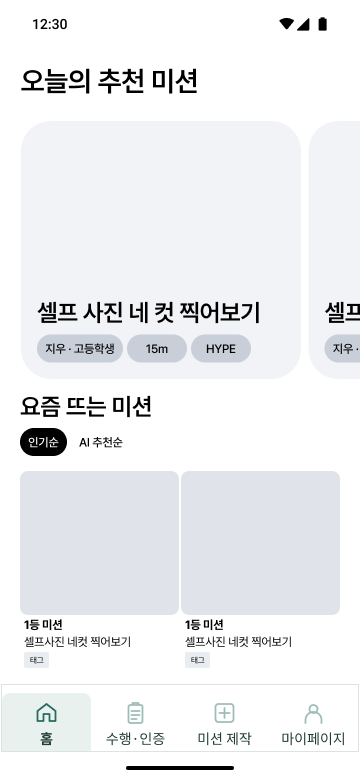
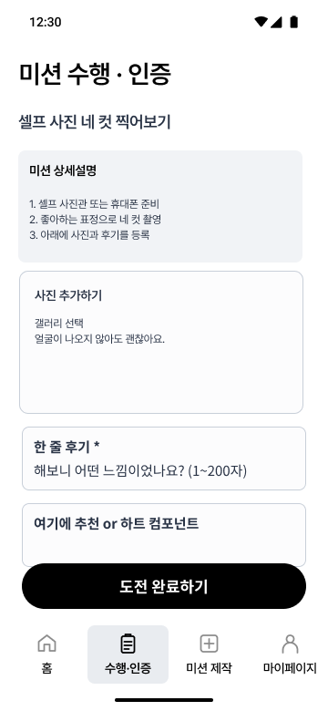
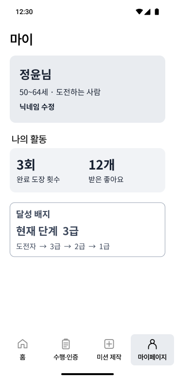
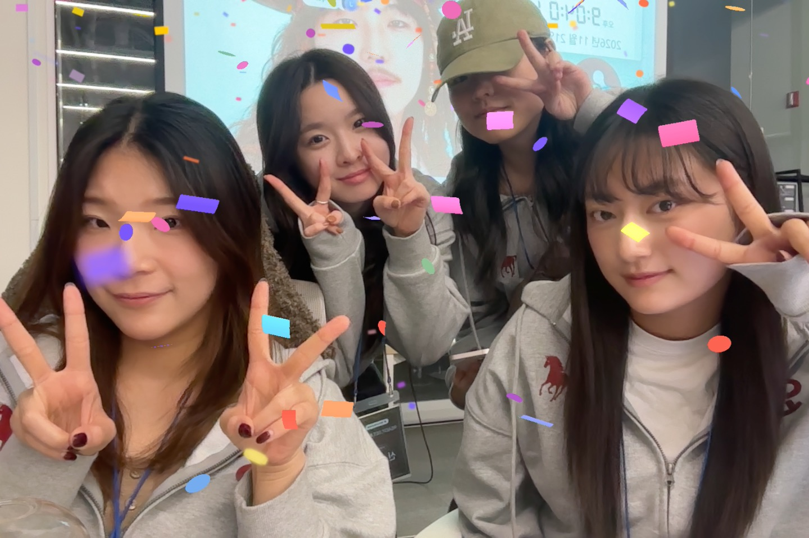

# 문화 미션 앱

> 서로의 문화를 가볍게 경험하고, 도전과 반응으로 연결되는 서비스

50~64세 사용자는 중고등학생이 소개한 음식, 사진·놀이, 음악, 디지털 문화에 미션으로 도전합니다. 중고등학생은 자신에게 익숙한 문화를 미션으로 만들고, 도전 후기에 응원과 답장을 보냅니다.

## 🖼 서비스 와이어프레임

[Figma에서 와이어프레임 보기](https://www.figma.com/design/tp9Y70zMyZ944nPijaq926/?node-id=4092-12)

홈에서 미션을 탐색하고 담은 뒤, 미션 수행·인증 탭에서 도전을 완료합니다. 미션 제작과 마이페이지까지의 화면 흐름을 확인할 수 있습니다.

| 홈 화면 | 수행·인증 화면 | 미션 제작 화면 | 마이페이지 화면 |
| :---: | :---: | :---: | :---: |
|  |  | 아직 제작 미완료 |  |

## 👥 팀원 및 역할

| 최은지 | 남궁혜민 | 신승연 | 정희진 |
| :---: | :---: | :---: | :---: |
|  |  |  |  |
| A · 홈 | B · 미션 수행·인증 | D · 마이페이지 | C · 미션 제작 |

## ✨ 주요 기능

### 50~64세 사용자

- 분야별 미션 탐색 및 상세 정보 확인
- 미션 참여와 도전 인증
- 사진, 한 줄 후기, 도전 후 기분 기록
- 참여 중·완료한 미션과 받은 반응 확인

### 중고등학생 사용자

- 문화 미션 작성 및 등록
- 자신이 만든 미션의 참여·완료 현황 확인
- 도전 후기 확인, 응원 및 답장 보내기

## 🛠 기술 스택

| 영역 | 기술 및 방식 |
| --- | --- |
| 언어 | Kotlin |
| UI | Jetpack Compose |
| 의존성 주입 | Hilt |
| 아키텍처 | MVVM, Google 권장 앱 아키텍처 |

> 세부 라이브러리와 버전은 구현이 확정되면 업데이트합니다.

## 🌿 컨벤션 및 브랜치 전략

### 브랜치

- `main`: 완성된 버전
- `develop`: 개발 완료된 기능을 통합하는 브랜치
- 기능 작업: 이슈 생성 후 작업 단위별 브랜치 사용
- 브랜치명: `유형/#이슈번호-작업내용`
  - 예: `feat/#30-mission-list`
- 브랜치 카테고리: `feat`, `mod`, `add`, `del`, `fix`, `refactor`

### 커밋

- 형식: `[카테고리/#이슈번호] 작업 내용`
  - 예: `[feat/#30] 미션 목록 화면 구현`
- 카테고리: `feat`, `mod`, `add`, `del`, `chore`, `fix`, `docs`, `init`
- 커밋은 가능한 한 작은 작업 단위로 나눕니다.

### 이슈 및 PR

- 이슈 제목: `[유형] 작업 내용`
- PR 제목: `[유형/#이슈번호] 작업 내용`
- PR에는 관련 이슈, 작업 내용, 화면 캡처 또는 영상을 작성합니다.
- 작성자 외 팀원의 코드 리뷰 후 PR 작성자가 `develop`에 머지합니다.
- 커밋·푸시·PR·머지 전 앱 빌드와 실행 상태를 확인합니다.

## 📸 Android 팀원 사진 (Before)

