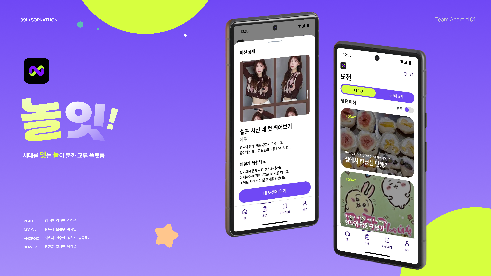
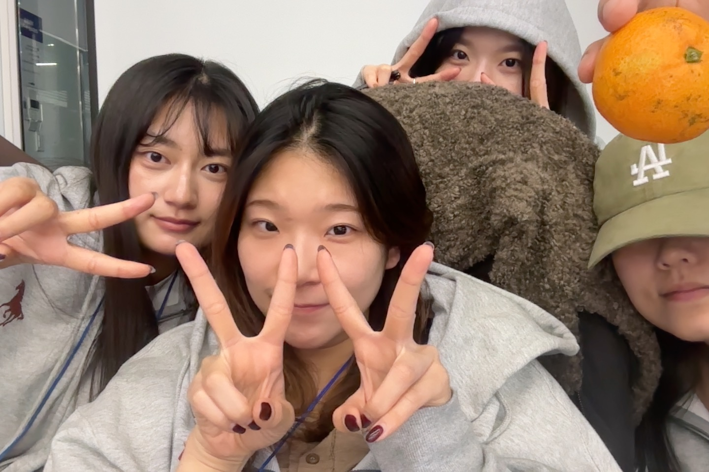

# 놀잇

중고등학생이 소개한 요즘 유행을 50~64세가 직접 따라 해보고 인증할 수 있는 문화 미션 앱

## 👥 팀원 및 역할

| 최은지 | 남궁혜민 | 신승연 | 정희진 |
| :---: | :---: | :---: | :---: |
|  |  |  |  |
| A · 홈 | B · 미션 수행·인증 | D · 마이페이지 | C · 미션 제작 |

## 📌 주요 기능

| 우선순위 | 기능                         |
| --- |----------------------------|
| Must | 미션 제작                      |
| Must | 홈 미션 둘러보기 (랜덤 추천 · 하입순 정렬) |
| Must | 도전 인증                      |
| Must | 하입 (미션 추천)                 |
| Should | 모두의 도전 (인증 커뮤니티)           |
| Should | 좋아요                        |
| Could | 마이페이지                      |

## 🛠 기술 스택

| 영역 | 기술 및 방식 |
| --- | --- |
| 언어 | Kotlin |
| UI | Jetpack Compose |
| 의존성 주입 | Hilt |
| 아키텍처 | MVVM, Google 권장 앱 아키텍처 |
| 네트워크 | Retrofit 3, OkHttp 5, kotlinx.serialization |
| 이미지 로딩 | Coil 3 |
| 내비게이션 | Navigation Compose 2.10 (직렬화 경로 객체) |

## 🌿 컨벤션 및 브랜치 전략
### 코딩컨벤션

| 이름 | naming rules |
| --- | --- |
| function | Lower Camel Case (Composable 함수는 Upper Camel Case) |
| variable | Lower Camel Case |
| class | Upper Camel Case (=Pascal Case) |
| interface | Upper Camel Case (=Pascal Case) |
| const val | Screaming Snake Case |
| drawable file name | 아래 drawable 규칙 참고 |
| dto class | Upper Camel Case (=Pascal Case) |
| retrofit function | Lower Camel Case |
| package | 소문자 |

#### drawable 규칙

- 영문 소문자와 `_`만 사용하며, 숫자로 시작하지 않습니다.
- 형식: `<종류>_<화면·용도>_<이름>`

| 종류 | 접두사 | 예시 |
| --- | --- | --- |
| 아이콘 | `ic_` | `ic_nav_home`, `ic_toast_error`, `ic_plus` |
| 이미지 | `img_` | `img_card_error`, `img_home_recommend_1` |

### 브랜치

- `main`: 완성된 버전
- `develop`: 개발 완료된 기능을 통합하는 브랜치
- 기능 작업: 이슈 생성 후 작업 단위별 브랜치 사용
- 브랜치명: `유형/#이슈번호-작업내용`
  - 예: `feat/#30-mission-list`
- 브랜치 카테고리: `feat`, `mod`, `add`, `del`, `fix`, `refactor`, `init`, `hotfix`

### 커밋

- 형식: `[카테고리/#이슈번호] 작업 내용`
  - 예: `[feat/#30] 미션 목록 화면 구현`
- 카테고리: `feat`, `mod`, `add`, `del`, `fix`, `refactor`, `init`, `hotfix`, `chore`, `docs`
- 커밋은 가능한 한 작은 작업 단위로 나눕니다.

### 이슈 및 PR

- 이슈 제목: `[유형] 작업 내용`
- PR 제목: `[유형/#이슈번호] 작업 내용`
- PR에는 관련 이슈, 작업 내용, 화면 캡처 또는 영상을 작성합니다.
- 작성자 외 팀원의 코드 리뷰 후 PR 작성자가 `develop`에 머지합니다.
- 커밋·푸시·PR·머지 전 앱 빌드와 실행 상태를 확인합니다.

## 📸 Android 팀원 사진 (Before)

## 📸 Android 팀원 사진 (After)

